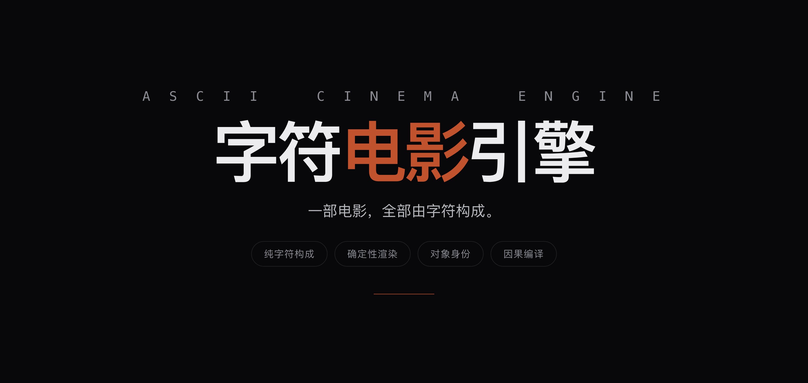

<div align="center">
  
</div>

<h1 align="center">ASCII Cinema Engine</h1>

<p align="center">
  <sub>
    <a href="https://github.com/YanKaFei/Costume-Director-Vault-Starter">Costume</a> ·
    <a href="https://github.com/YanKaFei/art-aesthetic-vault">Art</a> ·
    <a href="https://github.com/YanKaFei/ascii-cinema-engine">ASCII Cinema</a> ·
    <a href="https://github.com/YanKaFei/ascii-h3-director">ASCII H3</a> ·
    <a href="https://github.com/YanKaFei/2d-limited-mv-studio">2D MV</a> ·
    <a href="https://github.com/YanKaFei/virtual-heroine-atlas">Virtual Heroine</a>
  </sub>
</p>

**A film made entirely of characters.** 240×120 ASCII cells per frame, deterministic rendering, compiled causality and auditable invariants.

## What it is

A character-grid cinema engine: each frame is a 240×120 field of glyphs; identity, continuity and causal changes are tracked as data. The output is deterministic and testable — not an AI image sequence.

## Run

```bash
npm ci
npm run typecheck && npm run build
npm test
npm run gate:phase2
node scripts/pipeline.mjs --prompt <theme> --out out/<name>
```

External media and FFmpeg/Remotion binaries are not included; see `LICENSE.md`.

## DSH ecosystem

- [Costume Director Vault Starter](https://github.com/YanKaFei/Costume-Director-Vault-Starter) — costume visual knowledge
- [Art Aesthetic Vault](https://github.com/YanKaFei/art-aesthetic-vault) — art and film style layers
- [ASCII Cinema Engine](https://github.com/YanKaFei/ascii-cinema-engine) — character-grid cinema
- [ASCII H3 Director](https://github.com/YanKaFei/ascii-h3-director) — ASCII / kinetic-typography direction
- [2D Limited MV Studio](https://github.com/YanKaFei/2d-limited-mv-studio) — 2D anime MV prompt package
- [Virtual Heroine Atlas](https://github.com/YanKaFei/virtual-heroine-atlas) — virtual character research

## Licence

See [LICENSE.md](LICENSE.md).
