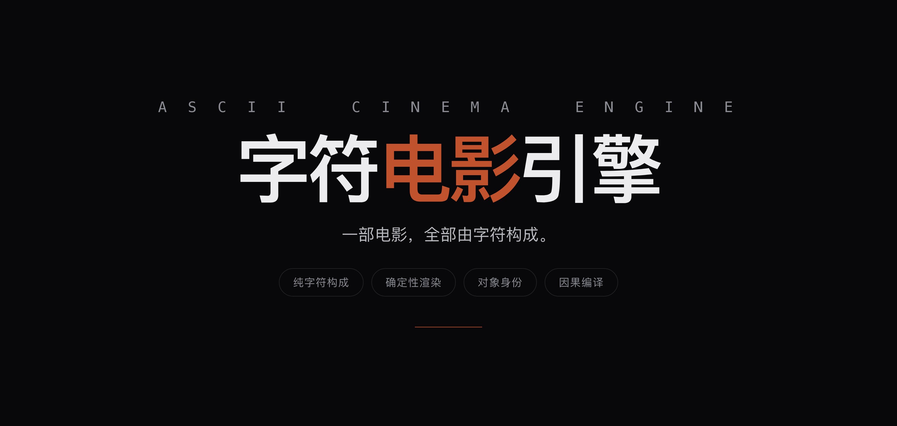

<div align="center">
  
</div>

<h1 align="center">ASCII Cinema Engine</h1>

<p align="center" data-ecosystem-nav="1"><sub><a href="https://github.com/YanKaFei/Costume-Director-Vault-Starter">Costume</a> · <a href="https://github.com/YanKaFei/art-aesthetic-vault">Art</a> · <a href="https://github.com/YanKaFei/ascii-cinema-engine">ASCII Cinema</a> · <a href="https://github.com/YanKaFei/ascii-h3-director">ASCII H3</a> · <a href="https://github.com/YanKaFei/2d-limited-mv-studio">2D MV</a> · <a href="https://github.com/YanKaFei/virtual-heroine-atlas">Virtual Heroine</a></sub></p>


<p align="center">
  <sub>
    <a href="https://github.com/YanKaFei/Costume-Director-Vault-Starter">Costume</a> ·
    <a href="https://github.com/YanKaFei/art-aesthetic-vault">Art</a> ·
    <a href="https://github.com/YanKaFei/ascii-cinema-engine">ASCII Cinema</a> ·
    <a href="https://github.com/YanKaFei/ascii-h3-director">ASCII H3</a> ·
    <a href="https://github.com/YanKaFei/2d-limited-mv-studio">2D MV</a> ·
    <a href="https://github.com/YanKaFei/virtual-heroine-atlas">Virtual Heroine</a>
  </sub>
</p>

**Un film fait entièrement de caractères.** 240×120 cellules ASCII par image, rendu déterministe, causalité compilée et invariants auditables.

## Qu’est-ce que c’est

Un moteur de cinéma en grille de caractères : chaque image est un champ de 240×120 glyphes ; identité, continuité et changements causaux sont suivis comme données. Ce n’est pas une séquence d’images IA, mais une sortie déterministe et testable.

## Lancer

```bash
npm ci
npm run typecheck && npm run build
npm test
npm run gate:phase2
```


## DSH ecosystem

- [Costume](https://github.com/YanKaFei/Costume-Director-Vault-Starter) — connaissances visuelles du costume
- [Art](https://github.com/YanKaFei/art-aesthetic-vault) — couches de style art et cinéma
- [ASCII Cinema](https://github.com/YanKaFei/ascii-cinema-engine) — cinéma en grille de caractères
- [ASCII H3](https://github.com/YanKaFei/ascii-h3-director) — direction ASCII / typographie cinétique
- [2D MV](https://github.com/YanKaFei/2d-limited-mv-studio) — package de prompts MV anime 2D
- [Virtual Heroine](https://github.com/YanKaFei/virtual-heroine-atlas) — recherche sur les personnages virtuels
