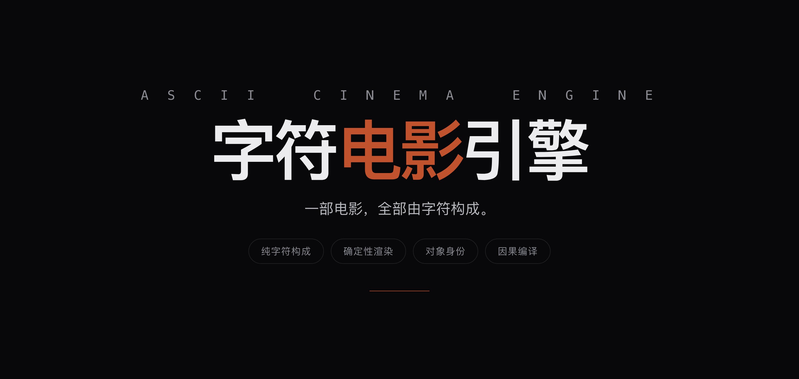

<div align="center">
  
</div>

<h1 align="center">ASCII Cinema Engine</h1>

<p align="center" data-ecosystem-nav="1"><sub><a href="https://github.com/YanKaFei/Costume-Director-Vault-Starter">Costume</a> · <a href="https://github.com/YanKaFei/art-aesthetic-vault">Art</a> · <a href="https://github.com/YanKaFei/ascii-cinema-engine">ASCII Cinema</a> · <a href="https://github.com/YanKaFei/ascii-h3-director">ASCII H3</a> · <a href="https://github.com/YanKaFei/2d-limited-mv-studio">2D MV</a> · <a href="https://github.com/YanKaFei/virtual-heroine-atlas">Virtual Heroine</a></sub></p>

<p align="center">
  <sub>
    <a href="https://github.com/YanKaFei/Costume-Director-Vault-Starter">Costume</a> ·
    <a href="https://github.com/YanKaFei/art-aesthetic-vault">Art</a> ·
    <a href="https://github.com/YanKaFei/ascii-cinema-engine">ASCII Cinema</a> ·
    <a href="https://github.com/YanKaFei/ascii-h3-director">ASCII H3</a> ·
    <a href="https://github.com/YanKaFei/2d-limited-mv-studio">2D MV</a> ·
    <a href="https://github.com/YanKaFei/virtual-heroine-atlas">Virtual Heroine</a>
  </sub>
</p>

**문자만으로 만든 영화.** 프레임당 240×120 ASCII 셀, 결정론적 렌더링, 컴파일된 인과성, 감사 가능한 불변량.

## 무엇인가

문자 그리드 시네마 엔진입니다. 각 프레임은 240×120 글리프 필드이고, 정체성·연속성·인과 변화를 데이터로 추적합니다. AI 이미지 시퀀스가 아니라 결정론적이고 테스트 가능한 출력입니다.

## 실행

```bash
npm ci
npm run typecheck && npm run build
npm test
npm run gate:phase2
```


## DSH ecosystem

- [Costume](https://github.com/YanKaFei/Costume-Director-Vault-Starter) — 의상 시각 지식
- [Art](https://github.com/YanKaFei/art-aesthetic-vault) — 예술·영화 스타일 레이어
- [ASCII Cinema](https://github.com/YanKaFei/ascii-cinema-engine) — 문자 그리드 시네마
- [ASCII H3](https://github.com/YanKaFei/ascii-h3-director) — ASCII / 키네틱 타이포그래피 연출
- [2D MV](https://github.com/YanKaFei/2d-limited-mv-studio) — 2D 애니메이션 MV 프롬프트
- [Virtual Heroine](https://github.com/YanKaFei/virtual-heroine-atlas) — 버추얼 캐릭터 연구
