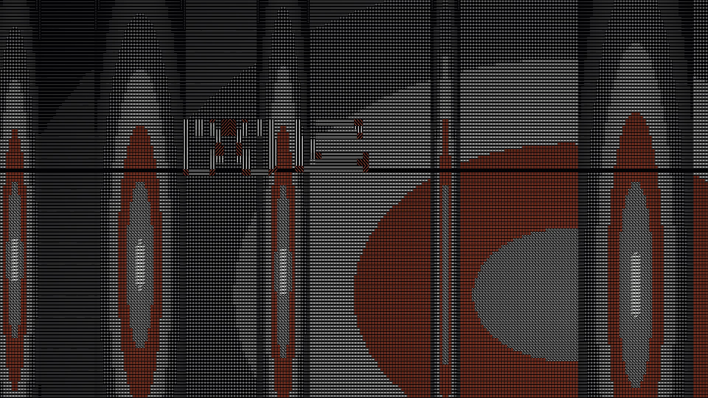
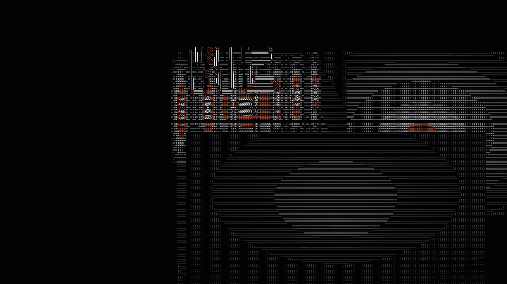
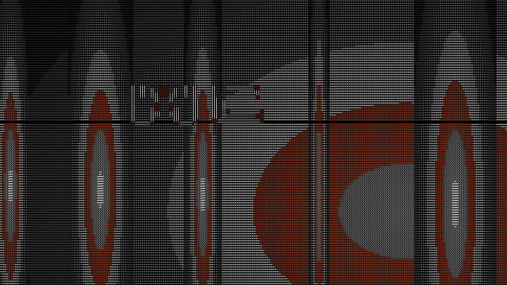

<div align="center">

# 字符电影引擎

### ASCII CINEMA ENGINE

**一部电影，全部由字符构成。**

*一个没有任何图像的渲染管线——每一帧都是 240 × 120 个可打印 ASCII 字符。*

<br>



<sub>`FRAME 292 / 480` · 1920×1080 · 16.000s · 30fps</sub>

<br>

**`纯字符构成`** · **`确定性渲染`** · **`对象身份`** · **`因果编译`**

</div>

---

## 简介

这是一个**字符电影引擎**：给它一个意图，它产出一部影片。

它和「把图片转成字符」是两件不同的事。这里**不存在任何源图像**——没有照片、没有视频素材、
没有预渲染的帧。影片是一组三维空间中的点图元，一台摄像机从中穿过，**摄像机看到的就是字符网格**。

每一帧的载体是 **240 × 120 = 28,800 个字符单元**。画面不是「看起来像字符」，
而是**逐格由字符本身构成**。

---

## 为什么它不只是「字符画」

<div align="center">



<sub>`FRAME 60` — 字符堆积成建筑的体量、立柱与层理</sub>

</div>

### 一、字符是有身份的

这是整件事的核心。绝大多数字符渲染是**无状态**的：每一帧把像素变成字符，帧与帧之间没有记忆——
没有「这一格字符上一帧在哪里」，也没有「它属于哪个字母」。

这个引擎里，**每个字符都有身份**：

| | |
|---|---|
| **来源** | 每个碎片知道自己是从哪个字形的哪一段拓扑单元出生的 |
| **连续性** | 载体跨越剪辑存活，携带身份与拓扑 |
| **可追溯** | 每一格像素都能回溯到 `图层 / 表示模式 / 材质 / 主体` |

正因为字符有身份，**它才能碎裂而不同时失去自己**。

<br>

<div align="center">



<sub>`FRAME 291` — 接缝张开，结构开始沿着自己的接缝失效</sub>

</div>

### 二、形变是被编译验证的因果，不是随机动画

影片里的变形有**作者化的因果对**。编译器独立重导出它的时刻，运行时严格在被验证的那一帧执行：

```
causeReadable  19  →  绝对帧 310
effectOnset    29  →  绝对帧 320     ← 表示变化恰好发生在这里
```

实测：帧 291–319 是 `SCENE_ASCII`，**帧 320 精确切换到 `GLYPH_FIELD`**，载体随之产生。

同一套表示变化链由编译器校验并保留：

```
SCENE_ASCII  →  TYPOGRAPHIC_GRAPHIC  →  GLYPH_FIELD
```

**物体在这三种表示中始终是同一个物体。**

<br>

<div align="center">


<sub>`FRAME 320` — 拓扑转化为字符场；同一个物体换了表示，没有换身份</sub>

</div>

### 三、结构本身会解体

碎裂不是往墙上叠一层粒子雾，而是**墙体材质本身被移除**。

侵蚀**从接缝向外**传播，而不是从每块面板的边框：每块面板声明接缝在**它自己参数空间**中的位置，
所以一条规则同时覆盖后墙、侧墙、地板与立柱。轮廓是拓扑性的，**在解构中完整存活**——
面板从不失去它在空间中的位置，它失去的是**实质**。

<br>

<div align="center">


<sub>`FRAME 345` — 墙体逐层剥离，接缝处打开一条真正可通行的通路</sub>

</div>

### 四、确定性

引擎是**逐字节可复现**的：同一份源码两次渲染，产物完全一致。

擦除图案、粒子分布、相位偏移全部来自 `(frame, x, y)` 的**纯整数哈希**——
**没有一处 `Math.random()`**。这不是洁癖：一部无法复现的影片，无法被审计，也无法被信任。

<br>

<div align="center">


<sub>`FRAME 470` — 所有材质最终收敛到一行仍然可读的字符</sub>

</div>

---

## 这部影片

**《缝》— SEAM** · 8 个镜头 · 480 帧 · 16.000 秒 · 无声

<div align="center">

| | 墨覆盖（实测解码像素） |
|---|---|
| 开场 | 0.087 |
| 平均 | 0.114 |
| **峰值（帧 292，碎裂段内）** | **0.294** |
| 结构解体最深（帧 330） | 0.119 |

</div>

<div align="center">


<sub>全片 480 帧的列平均——一条真实的时间签名，不是装饰</sub>

</div>

---

## 工程

| | |
|---|---|
| **语言 / 运行时** | TypeScript · Node ESM |
| **字符网格** | 240 × 120（28,800 单元/帧） |
| **输出** | 1920×1080 · 30fps · H.264 |
| **渲染** | 自研字符光栅化 → 帧缓冲 → 编码 |
| **不变量测试** | **518,975** 条断言 |
| **回归** | 两阶段 · **54** 道门 |
| **确定性** | 逐字节可复现（实测） |

### 架构分层

```
intent  →  compile  →  MotionIR  →  carriers  →  layer canvases  →  composite  →  raster  →  frame
   ↑                                                                     ↑
   └── 导演级契约：动机 · 因果 · 跨剪辑连续性，编译期强校验 ────────────────┘
```

四层独立画布（场景 / 主体 / 字形场 / 负空间遮罩），每层可单独停用、遮罩或换表示模式。

每次渲染产出一份**层账本**：每层「画了多少格 / 到达画面多少 / 被遮多少 / 被擦多少」。
一个声明了却一个像素都没到达的层会**直接让渲染失败**——惰性机制是这个引擎明确拒绝的东西。

---

<div align="center">

<br>

# ASCII CINEMA ENGINE

**A film made entirely of characters.**

*A pipeline with no images anywhere in it — every frame is 240 × 120 printable ASCII cells.*

<br>


</div>

---

## Overview

This is an **ASCII cinema engine**: give it an intent, it produces a film.

It is not an image-to-ASCII converter. **There are no source images** — no photographs, no footage,
no pre-rendered frames. A film is a set of point primitives in 3D space that a camera flies through,
and **the character grid is what the camera sees**.

The carrier of every frame is **240 × 120 = 28,800 character cells**. The image does not merely
*look like* characters — it **is** characters, cell by cell.

---

## Why this is not just "ASCII art"

<table>
<tr><td width="50%">


<sub>`FRAME 60` — characters accumulate into mass, columns and strata</sub>

</td><td width="50%">


<sub>`FRAME 291` — the seam opens; the structure fails along its own joint</sub>

</td></tr>
</table>

### 1. Characters have identity

This is the whole point. Almost all character rendering is **stateless**: each frame converts pixels
into characters with no memory between frames — no notion of where a cell was, or which letterform
it belongs to.

Here **every character has identity**: where it was born in its glyph's topology, which carrier it
travels with, and which `layer / representation mode / material / subject` every final pixel traces
back to.

Because characters have identity, **they can break apart without also losing themselves.**

### 2. Transformation is compiled causality, not random motion

The film's transformation has an **authored causal pair**. The compiler independently re-derives its
timing, and the runtime executes at exactly the validated frame:

```
causeReadable  19  →  absolute frame 310
effectOnset    29  →  absolute frame 320     ← the representation change happens here
```

Measured: frames 291–319 are `SCENE_ASCII`; **frame 320 switches exactly to `GLYPH_FIELD`** and the
carriers appear. The chain `SCENE_ASCII → TYPOGRAPHIC_GRAPHIC → GLYPH_FIELD` is validated and
preserved by the compiler, and **the object remains the same object across all three.**

<table>
<tr><td width="50%">


<sub>`FRAME 320` — topology becomes a character field: same object, new representation</sub>

</td><td width="50%">


<sub>`FRAME 345` — the wall peels away; a real passage opens at the seam</sub>

</td></tr>
</table>

### 3. The structure itself disintegrates

The break is not a particle haze laid over the walls. **The material of the walls is removed.**

Erosion propagates **outward from the seam**, not from each panel's own border: every panel declares
where the seam sits *in its own parametric space*, so one rule covers the back wall, the side walls,
the floor and the columns at once. The outline is topological, so it **survives deconstruction
entirely** — a panel never loses its place in space, only its substance.

### 4. Determinism

The engine is **byte-for-byte reproducible**: two renders of the same source produce identical output.

Erasure patterns, particle distribution and phase offsets all come from a **pure integer hash** of
`(frame, x, y)`. **There is no `Math.random()` anywhere.** This is not fastidiousness: a film that
cannot be reproduced cannot be audited, and cannot be trusted.

---

## The film

**《缝》— SEAM** · 8 shots · 480 frames · 16.000 s · silent

| | Ink coverage (measured on decoded pixels) |
|---|---|
| Opening | 0.087 |
| Mean | 0.114 |
| **Peak (frame 292, inside the break)** | **0.294** |
| Deepest disintegration (frame 330) | 0.119 |

<div align="center">


<sub>`FRAME 470` — everything the material was, reduced to one line that can still be read</sub>

</div>

---

## Engineering

| | |
|---|---|
| **Language / runtime** | TypeScript · Node ESM |
| **Character grid** | 240 × 120 (28,800 cells per frame) |
| **Output** | 1920×1080 · 30 fps · H.264 |
| **Rendering** | custom character rasteriser → frame buffer → encode |
| **Invariant tests** | **518,975** assertions |
| **Regression** | two phases · **54** gates |
| **Determinism** | byte-for-byte reproducible (verified) |

### Layers

```
intent  →  compile  →  MotionIR  →  carriers  →  layer canvases  →  composite  →  raster  →  frame
   ↑                                                                     ↑
   └── director-level contract: motivation · causality · cross-cut continuity ──┘
```

Four independent layer canvases (scene / subject / glyph field / negative-space mask). Each can be
disabled, masked or have its representation mode swapped in isolation.

Every render emits a **layer ledger**: per layer, how many cells were drawn, reached the frame, were
occluded, were erased. A declared layer that reaches **zero pixels fails the render** — an inert
mechanism is something this engine explicitly refuses.

---

<div align="center">

<br>

*Every frame in this repository is 28,800 characters. Nothing else.*

<br>

`#deepseek` `#deepseek-harness` `#ASCII` `#ASCIIArt` `#CreativeCoding` `#TypeScript` `#MotionDesign` `#ProceduralAnimation` `#GenerativeArt` `#CharacterGrid`

</div>
