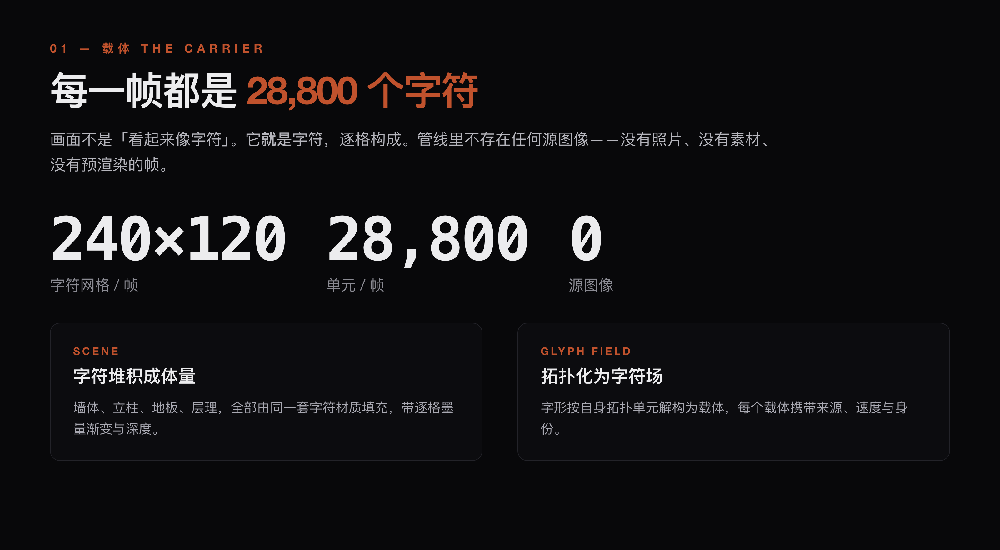
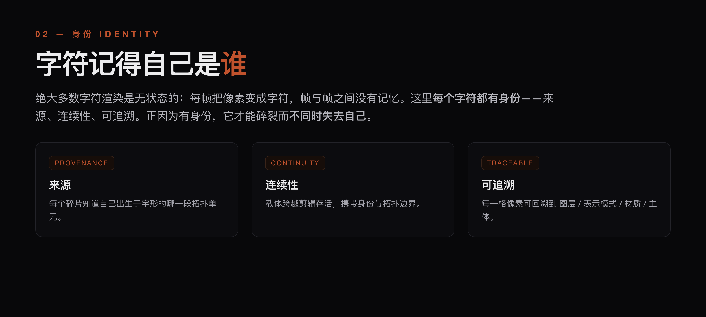
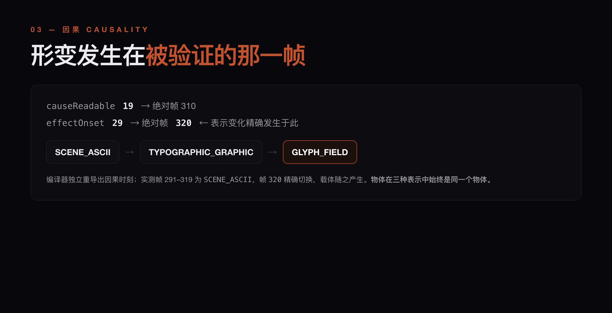
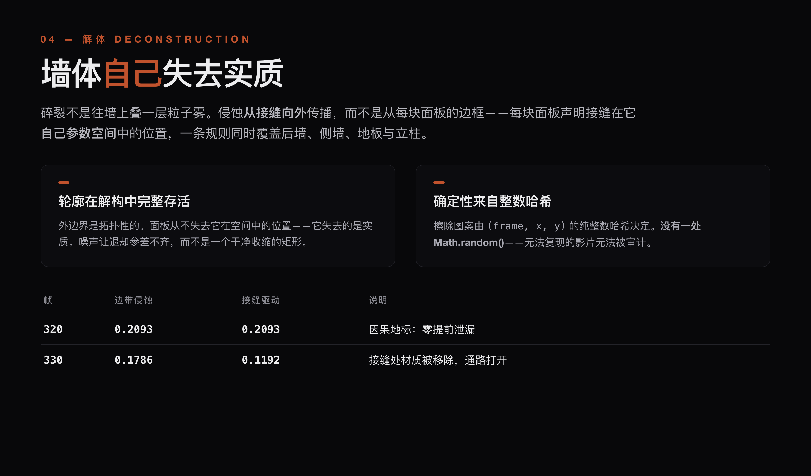
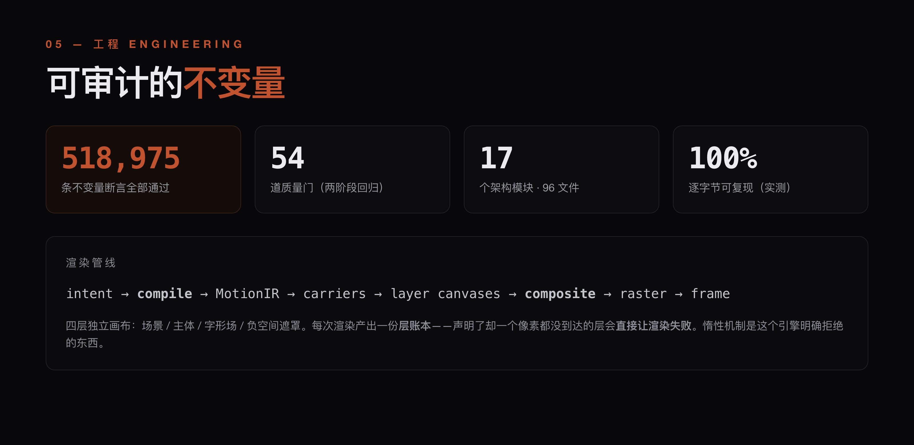
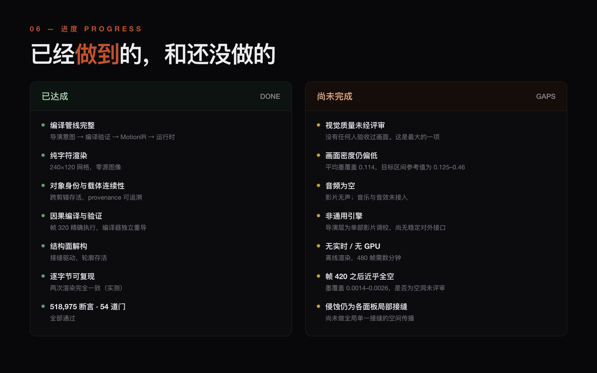
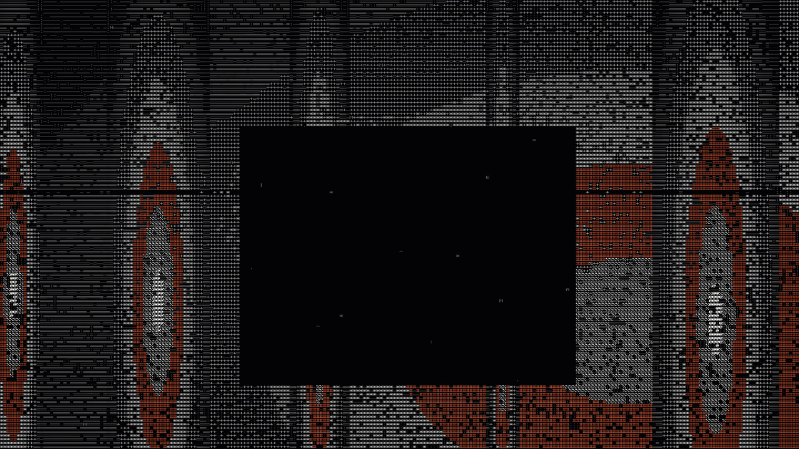
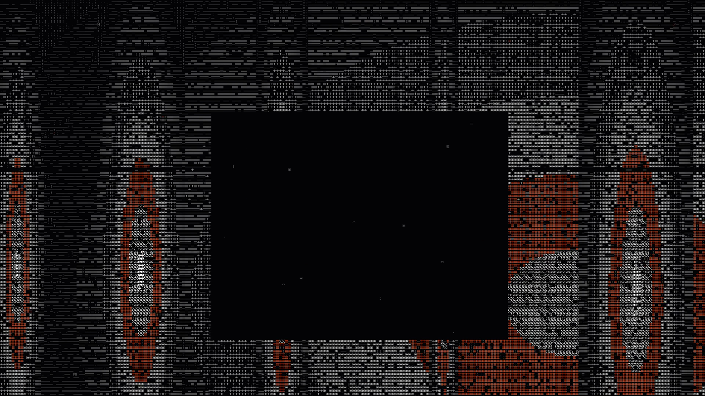
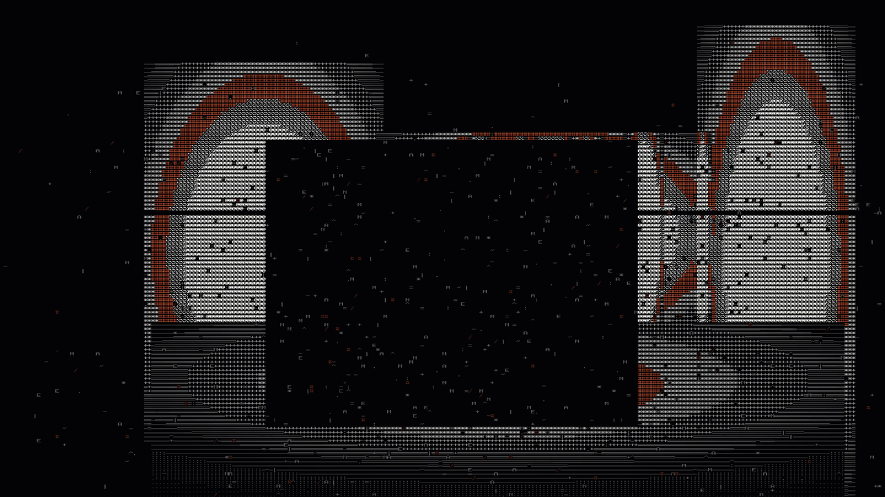

<div align="center">


</div>

<div align="center">



</div>

<div align="center">



</div>

<div align="center">



</div>

<div align="center">



</div>

<div align="center">



</div>

<div align="center">



</div>

---

<div align="center">







</div>

---

## 运行 / RUN

```bash
npm ci
npm run typecheck && npm run build

npm test          # 518,975 不变式断言
npm run gate:phase2   # 完整质量门：typecheck → build → test → 回归 → 基准 → 多样性
```

完整管线：

```bash
node scripts/pipeline.mjs --prompt <主题> --out out/<name>
```

### 环境变量

两个脚本需要**外部素材**，路径由环境变量提供，仓库内不含这些文件：

| 变量 | 用途 |
|---|---|
| `CINEMA_TRACK` | `scripts/phase4a3*.mjs` / `phase4b0-*.mjs` 的音频轨路径 |
| `CINEMA_PYTHON` | `scripts/phase4a3-independent.mjs` 用于独立比对的 Python 解释器 |

未设置时会**明确报错**，不会静默使用错误路径。

### 依赖的渲染工具链不在本仓库内

`node_modules` 与 FFmpeg / Remotion 平台二进制**不随仓库分发**（见 `LICENSE.md`）。
`out/draftt2/final-draftt2.mp4` 是已生成的成片，用于直接观看。

---

<div align="center">
<sub>ENGINE · 96 TypeScript files / 30,458 lines · 240 × 120 character grid · byte-for-byte reproducible</sub>
</div>
